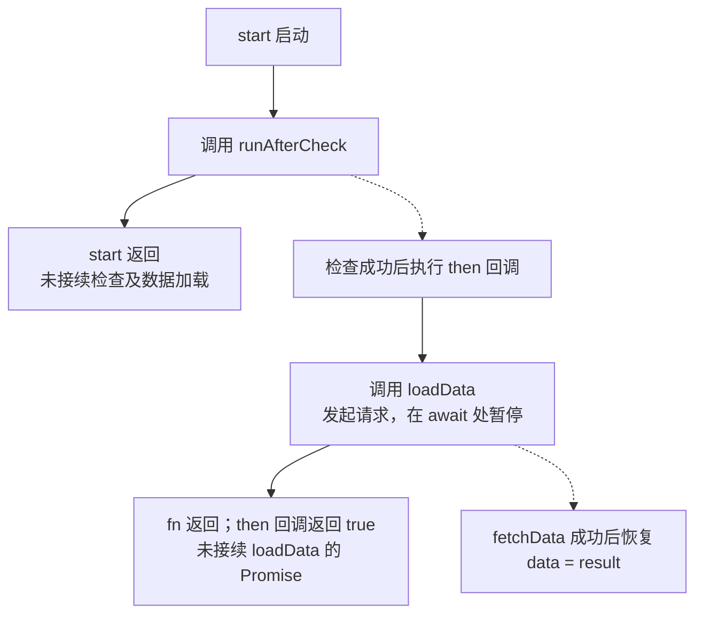
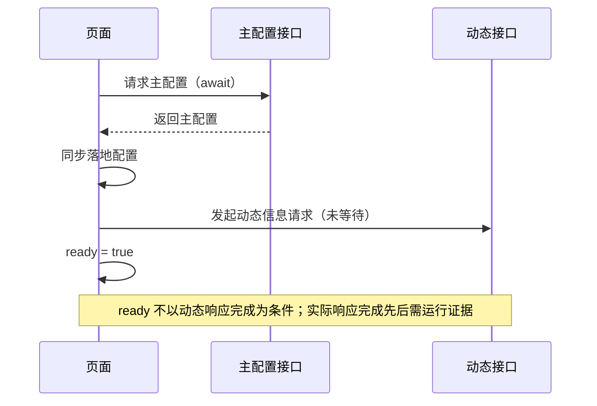

# 代码与异步链路检查

仅在对应代码出现时应用下面的检查，不把例子当成目标项目的固定结构。

## Promise 的边界取决于 return / await

下面假设 `checkAccess`、`fetchData` 返回原生 Promise，无额外同步写入；`data` 是普通状态变量。图仅展开成功路径。

```js
async function start() {
  runAfterCheck(() => {
    loadData()
  })
}
function runAfterCheck(fn) {
  return checkAccess().then(() => {
    fn()
    return true
  })
}
async function loadData() {
  const result = await fetchData()
  data = result
}
```

`start` 没有等待或返回 `runAfterCheck` 的 Promise。`runAfterCheck` 会执行回调的同步部分，包括启动 `loadData` 到第一个 `await`；但回调没有返回 `loadData` 的 Promise，`.then` 也没有接续它，因此等待 `runAfterCheck` 不能作为 `data` 已赋值的保证。

这个结论依赖示例中 `loadData` 的实现。若它改成同步赋值函数，赋值会在 `fn()` 返回前完成，也在 `runAfterCheck` 成功完成之前；若实现未知，只能确认调用和返回关系，不能断言业务工作何时完成。



实线表示同步执行，虚线表示异步后续。示例中的数据赋值在 `await` 恢复后发生，不会插入当前同步回调中；图不提供网络耗时，也不表示外部观察者在某次恢复执行时一定能看到哪种数据状态。

## 同步落地可能派生多个请求

```js
async function loadConfig() {
  const result = await queryConfig()
  processConfig(result)
  ready = true
}
function processConfig(result) {
  config = result
  loadDetails()
  setTimeout(showPopup, 500)
}
async function loadDetails() {
  detailsLoading = true
  const result = await fetchDetails()
  details = result
}
```

假设查询函数只返回原生 Promise，上述状态变量没有其他写入。成功路径设置 `ready` 前，`processConfig` 以及它调用的同步部分已经执行，包括 `config = result`、`detailsLoading = true`、发起详情请求和注册定时器。主线不等待详情的异步回填或定时器回调。

所以“未等待 `loadDetails` 的 Promise”不等于“未执行 `loadDetails`”。若调用同步抛错且未捕获，还可能阻止后续步骤；要按具体实现检查异常归属。`ready` 控制什么需追查消费点，状态已赋值也不能自动证明 DOM 已提交渲染。

## 框架派生任务

| 结构 | 检查内容 |
| --- | --- |
| Vue Options API | mixin 钩子与组件钩子、watch 条件、deep / immediate、watch 回调返回值是否被任何业务主线等待、nextTick 与 ref 可用性 |
| Vue Composition API | setup、onMounted、watch / watchEffect、flush 设置、路由和组合函数的初始化与清理 |
| React | 初始 state、render、effect 依赖、cleanup、自定义 Hook、路由 loader；仅在版本/运行环境明确时讨论 StrictMode 重复执行 |
| 定时器 / 事件 | 注册时机、回调入口、清理路径；排队不等于执行完成 |

不要依靠变量名字确认框架或默认时机。需要具体版本语义时，读取相关 manifest / lockfile 或对应文档。只提供片段且缺版本时，仍可解释明确的调用和写入，不强制索取完整项目。

## 请求失效与纠偏

- 请求编号、当前参数或业务上下文比较、AbortController、卸载标记分别约束什么？没有守卫的其他请求是否仍可能写入？
- 上游响应是否改变下游查询条件，使已获取的数据失效、需要重新查询？
- 重试或纠偏循环最多几轮；次数用尽时实际如何退出或交还控制权？
- 区分旧响应丢弃与业务失败，是否显示错误以实现为准。
- 主线 catch 不必然覆盖未 return 的请求、timer 和 watcher；逐项确认错误归属。

## 代码约束时序的表达

流程图强调条件和动作。调用图只表明连接，不承诺等待。时序图按参与方展开交互，适合解释 API、页面、缓存之间的消息关系。

下面是假设 `start` 会先等待配置，再启动但不等待动态信息的**代码约束时序**，不是观测到的请求完成记录：



没有观测记录时，不用虚构毫秒、t0/t1 网络完成时间填满时序图；已有日志时，明确日志对应哪个阶段和哪次请求。
