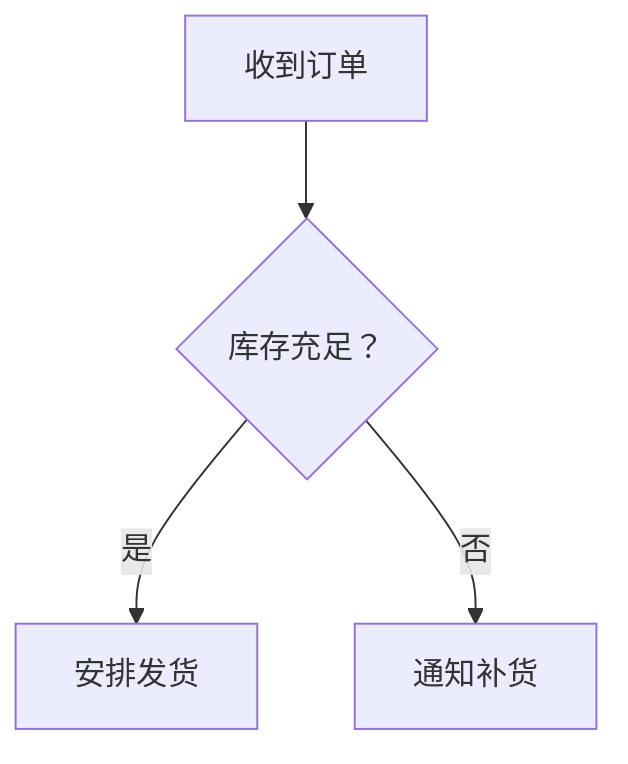
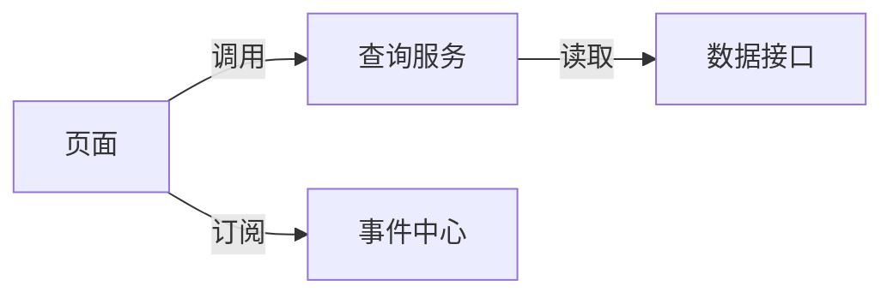
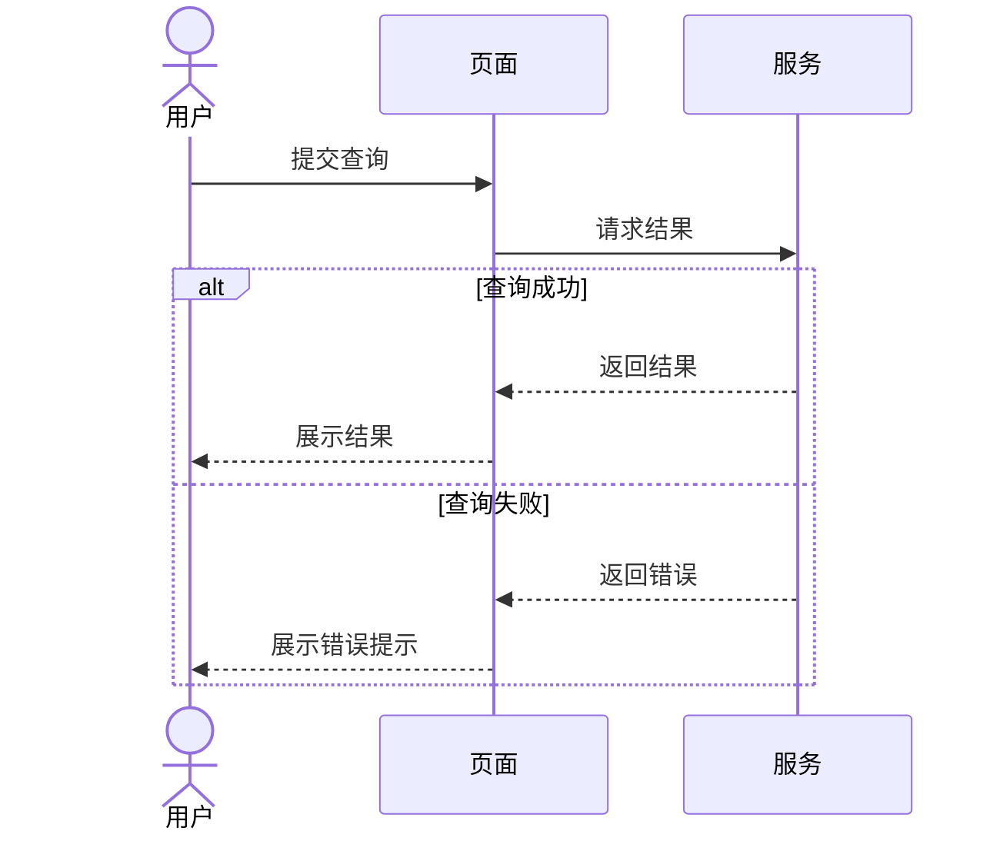
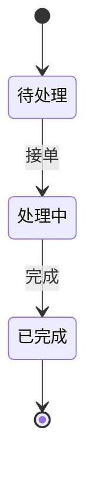
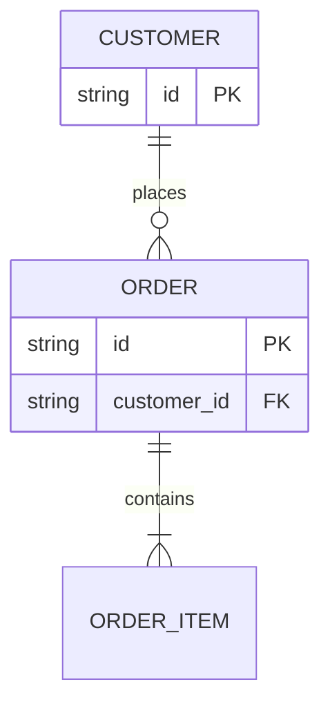
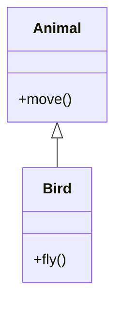
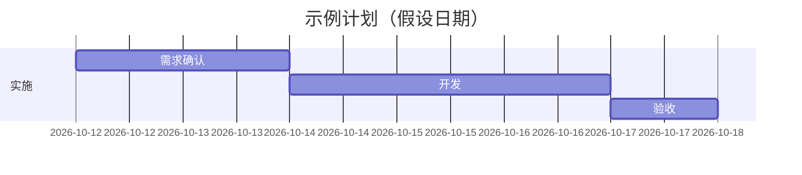

# 图型选择与示例

示例展示基本语法与表达角度，不代表每个场景都需要全部细节。用户指定图型时优先遵循；新图型的支持情况取决于宿主 Mermaid 版本。

## 流程图：动作和条件

决策边写条件，业务流程不必引入代码方法名、生命周期或异步术语。若规则中未说明缺货后续，就停在通知补货，不自行添加取消或退款。

## 调用 / 依赖关系图：连接不保证执行顺序

箭头标签使不同关系清楚。此图不能证明页面会先查询再订阅，也不能凭连线证明 await。

## 时序图：参与方与消息

时序图用参与方分工表达过程，`alt` 表示条件分支，`loop` 表示重复，`par` 可表达并发。箭头语法的意义遵循 Mermaid 类型，不将流程图自定义“虚线=后台任务”的图例机械套入时序图。

## 状态图：状态与触发事件

只有已知明确的起止状态才使用 `[*]`；不能给未说明的取消、重试和回退添加转移。

## ER 图：实体与基数

本例假定订单属于一个客户，客户可以没有订单；每个订单至少有一个明细。这些基数必须由业务规则支持。现实需求未给基数时先标明未知，或提供明确标注假设的方案。

## 类图：类型与继承

类图表达类型结构；对象间的请求通常用时序图更直接。不要仅根据文件目录推断继承或组合。

## 甘特图：计划与日期

示例是建议计划。真实输出中的日期和工期来自用户输入或明确的假设；需要时设置周末排除规则，不能擅自改变工作日定义。没有排期信息时，可以先用流程图表达阶段依赖。

## 让复杂图可读

- 先选阅读入口和终点，如“打开页面到列表可见”；主干保留决定结果的动作，方法名作定位，细节放子图或图后说明。分支应能看出汇合、退出或继续独立运行。
- 跨组件图按职责分组，单页复杂流程可按阶段分组；组内节点仍表达同一种关系。事件从谁发出、由谁处理，与数据归谁、被谁读取应能分别追踪。
- 同一状态的多条写入边汇入同一节点，不为消除交叉线把它画成几个独立状态。若拆图，保留一致名称与明确的展开/引用关系。
- 色彩、形状、线型只承担明确含义，跨图保持一致；判断用判断节点，普通动作不因“重要”变成判断。主次靠结构和简短标签体现。
