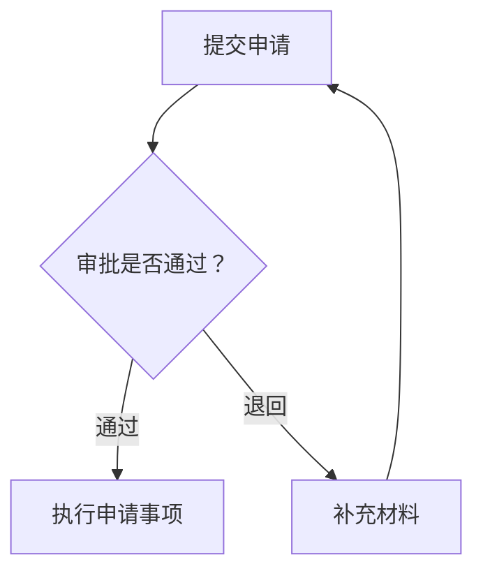

# Mermaid 输出模板

这些模板按用途选择，不要求每次填满所有栏目，也不固定图的数量。

## 简短回答

先用一句话说明图表达什么，再给完整的 Mermaid 代码块。需要时补充一两条图例、关键条件或假设。

例如审批流程：



## Markdown 文档

```text
# <主题> <图的名称>

<图表达的范围及读者最需要知道的一点>

## 总览（复杂内容才需要分章节）
<完整 Mermaid 代码块>
<必要的箭头、条件和分组说明>

## 关键子流程或另一观察角度（可选）
<第二张图；标明与总览的衔接>

## 关键规则 / 定位 / 假设（按需要选用）
<简短说明或表格>
<源码分析可给文件/方法依据；计划可给日期假设；关系模型可给未确定基数>

## 验证与待确认（存在实质限制时）
<实际验证方式、未确认范围、所需最小信息>
```

输出文件按用户指定路径保存。附件链接使用实际可达的相对路径；Markdown 本体保留图的源码，不只引用截图或交互页面。

## 更新现有图

- 先定位要更新的章节和 Mermaid 代码块，只改目标范围；保留无关正文、其他图和原有链接。
- 保留已有 ID 和命名能减少 diff 时优先保留，不为了美观全面重命名。
- 要求“更清楚”时可精简标签、调整方向、分组和拆图；保持关系、条件和顺序含义。
- 用户改变业务规则时，同步更新对应连线和图后的说明，避免旧规则残留。
- 多张图共用对象时命名一致；若观察粒度不同，在图标题或说明中交代。
